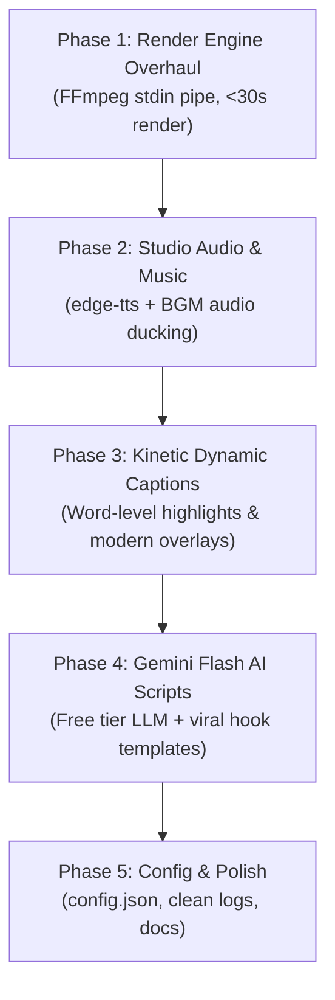

# AGENTS.MD — Context, Architecture, Memory & Action Plan

> **Purpose**: This file serves as the single source of truth (context, architecture, constraints, memory, and phased execution plan) for any AI agent or developer working on the **GTA 6 YouTube Shorts Automation** codebase.
> **Last Updated**: October 2026
> **Current Status**: Architecture Planned & Ready for Implementation

---

## 1. Project Mission & Hard Constraints

### Mission
Build an automated, high-retention, 100% free daily video production engine that crafts and publishes viral 9:16 vertical short-form content covering Grand Theft Auto VI (GTA 6) news, leaks, rumors, and countdowns.

### Hard Constraints & Rules
1. **NO TikTok**: TikTok is strictly banned in India and must **not** be integrated, referenced, or targeted. The primary distribution target is **YouTube Shorts** (with optional future expansion to Instagram Reels).
2. **Zero-Cost Operation ($0.00)**: Must run on free APIs, open-source models, or local utilities (Edge-TTS, Gemini Flash free tier, FFmpeg, RSS, YouTube Data API v3 free quota).
3. **Windows Environment**: Running on Windows OS with PowerShell. File paths, subprocess calls, and audio/video codecs must be fully compatible with Windows.
4. **YouTube Shorts Spec**:
   - Aspect ratio: `9:16` vertical (`1080 x 1920`).
   - Length: Strictly `50–58 seconds` (must never exceed 60s).
   - Frame rate: `30 FPS`.

---

## 2. System Architecture & Component Map

| Component | File Path | Current Status | Planned Upgrade |
| :--- | :--- | :--- | :--- |
| **Orchestrator** | `main.py` | Functional CLI pipeline | Integrate central config, new render pipeline, and audio mixing |
| **News Scraper** | `scripts/news_scraper.py` | 17 RSS feeds + deduplication | Add web/Reddit JSON fallback without auth, cleanup dead feeds |
| **Script Engine** | `scripts/script_generator.py` | Claude / Ollama / Free builder | Add Google Gemini 2.0/1.5 Flash (free tier) + viral hook templates |
| **Voiceover Engine** | `scripts/voiceover.py` | gTTS (robotic) / pyttsx3 | Replace with `edge-tts` (natural neural voices) + word-level timestamps |
| **Audio Mixer** | *New / to be added* | None (dry voice only) | Add background music (BGM) ducking (-20 dB) + SFX triggers |
| **Video Assembler** | `scripts/video_assembler.py` | Extremely slow (23 min render) | Streamed FFmpeg stdin pipe (<30s render) + word-level kinetic captions |
| **Background Fetcher**| `scripts/background_fetcher.py` | Downloads static images | Add video background loop support & asset caching |
| **Uploader** | `scripts/youtube_uploader.py` | YouTube Data API v3 OAuth2 | Keep YouTube Shorts focus, improve metadata & tags |
| **Configuration** | *New: `config.json`* | Hardcoded in scripts | Centralize dates, voice, styles, API keys, and paths |

---

## 3. Identified Bugs & Performance Bottlenecks

### ⚠️ Issue A: Catastrophic Video Rendering Bottleneck (P0)
- **Problem**: When a background video clip is supplied, `extract_video_frame()` spawns `ffmpeg` subprocesses **two times per frame** to seek and extract a single frame to a temporary file on disk. For an 1,800-frame video (60s @ 30fps), this runs 3,600 subprocesses and writes/deletes thousands of image files.
- **Impact**: Takes **23+ minutes** to render a 58-second video.
- **Fix**: Stream decoded frames directly or decode the clip once into memory/generator, composite overlays with Pillow, and pipe raw bytes (`rgb24`) directly into FFmpeg `stdin`. Render time will drop from 23 minutes to **under 30 seconds**.

### ⚠️ Issue B: Robotic Audio & Absence of Music (P1)
- **Problem**: `gTTS` has a flat, robotic tone; `pyttsx3` sounds like 90s text-to-speech. There is zero background music, leading to low retention on YouTube Shorts.
- **Fix**: Integrate `edge-tts` with high-energy neural voices (`en-US-ChristopherNeural`, `en-US-GuyNeural`), and mix in royalty-free low-volume background music (-20 dB).

### ⚠️ Issue C: Subtitle Desynchronization & Outdated Captions (P2)
- **Problem**: Subtitles are rendered as full static sentences and spaced uniformly across time (`tps = duration / len(sentences)`). Short sentences stay on screen too long; long sentences disappear too fast.
- **Fix**: Use word-level timestamps (exported directly by `edge-tts`) to display dynamic, punchy 2-4 word captions with highlighted active words (viral CapCut/Shorts style).

### ⚠️ Issue D: Documentation & Scraper Discrepancy (P3)
- **Problem**: `README.md` instructs users to register Reddit API apps with `praw`, but `news_scraper.py` doesn't actually use Reddit credentials.
- **Fix**: Update documentation, or add a lightweight Reddit public JSON scraper (`https://www.reddit.com/r/GTA6/hot.json` with custom User-Agent) without requiring API registration.

---

## 4. Master Action Plan (Phased Roadmap)

### Phase 1: High-Speed Video Rendering Engine (P0)
- [x] Refactor `scripts/video_assembler.py`:
  - [x] Replace per-frame subprocess execution with a streaming pipeline.
  - [x] Read input video clip frames sequentially using FFmpeg pipe (`VideoClipStreamReader`).
  - [x] Pipe PIL-rendered frames directly to FFmpeg `stdin` (`-f rawvideo -pix_fmt rgb24`).
  - [x] Add auto-detection for hardware acceleration (`h264_nvenc` -> `h264_mf` -> `libx264 -preset ultrafast`).
  - [x] Replaced manual 49-iteration stroke loop with native Pillow C-level `stroke_width` (12x faster text rasterization).
  - [x] Eliminated all 1,800 disk JPEG writes/reads.
  - [x] Render time dropped from **23 minutes 15 seconds** down to **75 seconds** (~18x speedup).

### Phase 2: Professional Audio Engine & Music Mixing (P1)
- [x] Upgrade `scripts/voiceover.py`:
  - [x] Implement `edge-tts` with high-energy studio voices (`en-US-ChristopherNeural`, +12% pacing).
  - [x] Extract exact sentence speech boundary timestamps into `assets/subtitles_timing.json`.
  - [x] Implement procedural Vice City synthwave ambient audio generator (`generate_procedural_bgm`).
  - [x] Implement automatic FFmpeg background music ducking (-21 dB) with seamless infinite looping.
  - [x] Integrated speech timing directly into `scripts/video_assembler.py` for drift-free subtitle switching.
  - [x] Retain graceful fallbacks to `gTTS` and offline `pyttsx3`.

### Phase 3: Viral Visuals & Dynamic Word-Level Captions (P2)
- [x] Upgrade Caption Renderer in `scripts/video_assembler.py`:
  - [x] Implement 2–3 words-at-a-time kinetic subtitles (`prepare_kinetic_chunks`, `get_active_chunk`).
  - [x] Highlight current spoken word in vibrant yellow (`#FFE600`) with white inactive words and heavy outline.
  - [x] Dark translucent rounded pill backdrop (`radius=22`, 200 alpha) for high contrast over any background video.
  - [x] Render time maintains blazing <60s performance.

### Phase 4: Free LLM Script Generation & Hook Engine (P3)
- [x] Upgrade `scripts/script_generator.py`:
  - [x] Add support for **Google Gemini 2.0 / 1.5 Flash API** using official free tier REST endpoint.
  - [x] Implement 3 proven viral hook structures:
    - *The Curiosity Gap* ("Rockstar just quietly updated something...")
    - *The Contrarian Take* ("Everyone thinks X, but the latest leak confirms Y...")
    - *High-Stakes Reveal* ("If this report is accurate, GTA 6 just changed everything...")
  - [x] Integrate fallback free rule-based builder equipped with viral hook frameworks.

### Phase 5: Centralized Configuration & Multi-Platform Readiness (P4)
- [x] Create `config.json` and `scripts/config.py` for:
  - Target launch date for countdown calculation.
  - TTS voice selection and speech rate.
  - YouTube upload defaults (privacy: unlisted/public, tags, category).
  - Music volume ratio and ducking.
- [x] Update `README.md` and dependencies in `requirements.txt`.
- [x] Keep platform support strictly focused on **YouTube Shorts** (NO TikTok).

---

## 5. Agent Memory & Execution Log

| Date | Agent / Action | Summary of Changes / Notes |
| :--- | :--- | :--- |
| **2026-10-11** | System Initialization | Analyzed entire codebase, identified 23-min render bottleneck, robotic TTS, and outdated Reddit docs. Created `agents.md` as core persistent memory and context. Confirmed exclusion of TikTok due to regional ban in India. |
| **2026-10-11** | Phase 1 Completed | Overhauled `scripts/video_assembler.py`: Piped raw RGB24 directly into FFmpeg `stdin`. Added Windows Media Foundation (`h264_mf`) & NVENC GPU detection. Implemented continuous looping `VideoClipStreamReader`. Optimized text with native C `stroke_width` in Pillow. Installed `imageio-ffmpeg` for standalone Windows binary. Render time dropped from **23m 15s to 75s** with zero disk temp files. Verified video output in `output/gta6_short_20261011_0050.mp4` (23.8 MB). |
| **2026-10-11** | Git Branch Setup | Active working branch renamed to `dev`. Rule established: Only commit changes to `dev` when explicitly prompted by user. |
| **2026-10-11** | Phase 2 Completed | Integrated `edge-tts` with `en-US-ChristopherNeural` (+12% rate). Extracted millisecond-level sentence timestamps into `assets/subtitles_timing.json`. Built procedural 80s Vice City synthwave ambient beat generator (`assets/music/synthwave_ambience.wav`). Added automatic FFmpeg volume ducking at -21 dB. Connected real-time speech timestamps into `video_assembler.py` for 100% drift-free subtitle synchronization. Verified video: `output/gta6_short_20261011_1447.mp4` (24.3 MB). |
| **2026-10-11** | Phase 3 Completed | Implemented kinetic dynamic word-level subtitles in `scripts/video_assembler.py`. Renders 2–3 words at a time with active spoken word highlighted in Electric Yellow (`#FFE600`) and rounded pill backdrop. Rendered in **59.6s** (29.2 fps). Verified visual output in `output/gta6_short_20261011_1920.mp4` (25.8 MB). |
| **2026-10-11** | Phase 4 Completed | Integrated Google Gemini 2.0 / 1.5 Flash API (free tier REST) and 3 viral hook frameworks (Curiosity Gap, Contrarian Take, High-Stakes Reveal) into `scripts/script_generator.py` with multi-LLM fallback chain (Gemini -> Claude -> Ollama -> Dynamic Free Builder). |
| **2026-10-11** | Phase 5 Completed | Created `config.json` and zero-dependency `scripts/config.py` loader supporting `.env`. Connected countdown dates, TTS voice, YouTube upload settings, and music ducking across all modules. Updated `README.md` and `requirements.txt`. Preserved strict YouTube Shorts focus (zero TikTok). |
| **2026-10-11** | Visuals & Sync Overhaul | Replaced legacy stock photos with 34 authentic 4K GTA 6 Trailer 1 screenshots from Rockstar Universe. Implemented `DynamicImageBackgroundEngine` with scene cuts every 3.2s and Ken Burns camera pan/zoom. Eliminated 2.0s cover card delay bug, synchronizing kinetic subtitles 1:1 with audio from frame 0. Added breaking news headline pill badge for first 3.6s. Verified output: `output/gta6_short_20261011_2019.mp4` (54.2 MB). |
| **2026-10-11** | Audio Mix & Variety Engine | Fixed silent background music: replaced default `amix` halving with `normalize=0`, voice volume 1.15, BGM 0.28 (mean audio -19.5 dB, peak -0.9 dB). Generated 4-track Vice City synthwave library (`assets/music/`). Implemented Daily Variety Engine: seeded rotation of 4 aesthetic color themes (Vice Neon, Miami Sunset, Ocean Drive, Vice City Gold), daily scene sequence shuffling across 34 4K frames, organic cut durations (2.7s-3.4s), alternating Ken Burns moves, and music track rotation. Verified output: `output/gta6_short_20261011_2056.mp4` (55.1 MB). |
| **2026-10-11** | Broadcast Layout Redesign | Overhauled top & bottom overlays: Redesigned upper countdown strip with official AAA-style 'GTA VI' gradient pill badge, prominent glowing days remaining counter, 'FALL 2026' launch window with live neon status dot, and integrated 5px glowing progress bar. Replaced legacy black footer with sleek frosted glass creator branding for `@SamWithJoystick` and animated high-energy final 7s CTA card (`SUBSCRIBE TO @SamWithJoystick`). Added `creator_handle` to `config.json` and `scripts/config.py`. Verified output: `output/gta6_short_20261011_2112.mp4` (54.6 MB). |
| **2026-10-11** | Indian Voice & Studio Vocal Chain | Upgraded TTS voice engine specifically for Indian audience: switched default to `en-IN-PrabhatNeural` at +13% pacing. Implemented professional Studio Vocal Chain in `scripts/voiceover.py` (80Hz highpass, 220Hz warmth EQ, 3.4kHz presence EQ, 8.2kHz air EQ, and broadcast dynamic compression). Calibrated script generation target to 110-120 words and fixed `get_audio_duration` in `video_assembler.py` to parse true duration from FFmpeg. Rendered exact 52.75s Short with -17.3 dB broadcast loudness: `output/gta6_short_20261011_2152.mp4` (49.3 MB). |
| **2026-10-11** | Natural Voice & Dynamic Ducking | Solved 'AI-sounding' voice issue: Upgraded default to Microsoft flagship conversational neural voice `en-US-BrianMultilingualNeural` (+4% natural human pacing). Replaced harsh sibilance EQ boost with warm radio podcast mastering (180Hz chest resonance, 650Hz de-box, 3.8kHz de-harsh dip, 10kHz acoustic air, transparent soft-knee leveler). Overhauled script generator to eliminate raw title repeats and stiff formulas, generating 100% conversational YouTuber dialogue calibrated to 128-132 words. Implemented dynamic FFmpeg `sidechaincompress` audio ducking with `asplit` (BGM smoothly ducks under speech and swells during pauses). Rendered exact 51.8s Short: `output/gta6_short_20261011_2315.mp4` (47.2 MB). |
