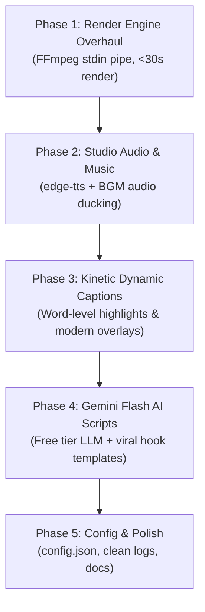

# AGENTS.MD — Context, Architecture, Memory & Action Plan

> **Purpose**: This file serves as the single source of truth (context, architecture, constraints, memory, and phased execution plan) for any AI agent or developer working on the **GTA 6 YouTube Shorts Automation** codebase.
> **Last Updated**: October 2026
> **Current Status**: Architecture Planned & Ready for Implementation

---

## 1. Project Mission & Hard Constraints

### Mission
Build an automated, high-retention, 100% free daily video production engine that crafts and publishes viral 9:16 vertical short-form content covering Grand Theft Auto VI (GTA 6) news, leaks, rumors, and countdowns.

### Hard Constraints & Rules
1. **NO TikTok**: TikTok is strictly banned in India and must **not** be integrated, referenced, or targeted. The primary distribution target is **YouTube Shorts** (with optional future expansion to Instagram Reels).
2. **Zero-Cost Operation ($0.00)**: Must run on free APIs, open-source models, or local utilities (Edge-TTS, Gemini Flash free tier, FFmpeg, RSS, YouTube Data API v3 free quota).
3. **Windows Environment**: Running on Windows OS with PowerShell. File paths, subprocess calls, and audio/video codecs must be fully compatible with Windows.
4. **YouTube Shorts Spec**:
   - Aspect ratio: `9:16` vertical (`1080 x 1920`).
   - Length: Strictly `50–58 seconds` (must never exceed 60s).
   - Frame rate: `30 FPS`.

---

## 2. System Architecture & Component Map

| Component | File Path | Current Status | Planned Upgrade |
| :--- | :--- | :--- | :--- |
| **Orchestrator** | `main.py` | Functional CLI pipeline | Integrate central config, new render pipeline, and audio mixing |
| **News Scraper** | `scripts/news_scraper.py` | 17 RSS feeds + deduplication | Add web/Reddit JSON fallback without auth, cleanup dead feeds |
| **Script Engine** | `scripts/script_generator.py` | Claude / Ollama / Free builder | Add Google Gemini 2.0/1.5 Flash (free tier) + viral hook templates |
| **Voiceover Engine** | `scripts/voiceover.py` | gTTS (robotic) / pyttsx3 | Replace with `edge-tts` (natural neural voices) + word-level timestamps |
| **Audio Mixer** | *New / to be added* | None (dry voice only) | Add background music (BGM) ducking (-20 dB) + SFX triggers |
| **Video Assembler** | `scripts/video_assembler.py` | Extremely slow (23 min render) | Streamed FFmpeg stdin pipe (<30s render) + word-level kinetic captions |
| **Background Fetcher**| `scripts/background_fetcher.py` | Downloads static images | Add video background loop support & asset caching |
| **Uploader** | `scripts/youtube_uploader.py` | YouTube Data API v3 OAuth2 | Keep YouTube Shorts focus, improve metadata & tags |
| **Configuration** | *New: `config.json`* | Hardcoded in scripts | Centralize dates, voice, styles, API keys, and paths |

---

## 3. Identified Bugs & Performance Bottlenecks

### ⚠️ Issue A: Catastrophic Video Rendering Bottleneck (P0)
- **Problem**: When a background video clip is supplied, `extract_video_frame()` spawns `ffmpeg` subprocesses **two times per frame** to seek and extract a single frame to a temporary file on disk. For an 1,800-frame video (60s @ 30fps), this runs 3,600 subprocesses and writes/deletes thousands of image files.
- **Impact**: Takes **23+ minutes** to render a 58-second video.
- **Fix**: Stream decoded frames directly or decode the clip once into memory/generator, composite overlays with Pillow, and pipe raw bytes (`rgb24`) directly into FFmpeg `stdin`. Render time will drop from 23 minutes to **under 30 seconds**.

### ⚠️ Issue B: Robotic Audio & Absence of Music (P1)
- **Problem**: `gTTS` has a flat, robotic tone; `pyttsx3` sounds like 90s text-to-speech. There is zero background music, leading to low retention on YouTube Shorts.
- **Fix**: Integrate `edge-tts` with high-energy neural voices (`en-US-ChristopherNeural`, `en-US-GuyNeural`), and mix in royalty-free low-volume background music (-20 dB).

### ⚠️ Issue C: Subtitle Desynchronization & Outdated Captions (P2)
- **Problem**: Subtitles are rendered as full static sentences and spaced uniformly across time (`tps = duration / len(sentences)`). Short sentences stay on screen too long; long sentences disappear too fast.
- **Fix**: Use word-level timestamps (exported directly by `edge-tts`) to display dynamic, punchy 2-4 word captions with highlighted active words (viral CapCut/Shorts style).

### ⚠️ Issue D: Documentation & Scraper Discrepancy (P3)
- **Problem**: `README.md` instructs users to register Reddit API apps with `praw`, but `news_scraper.py` doesn't actually use Reddit credentials.
- **Fix**: Update documentation, or add a lightweight Reddit public JSON scraper (`https://www.reddit.com/r/GTA6/hot.json` with custom User-Agent) without requiring API registration.

---

## 4. Master Action Plan (Phased Roadmap)

### Phase 1: High-Speed Video Rendering Engine (P0)
- [x] Refactor `scripts/video_assembler.py`:
  - [x] Replace per-frame subprocess execution with a streaming pipeline.
  - [x] Read input video clip frames sequentially using FFmpeg pipe (`VideoClipStreamReader`).
  - [x] Pipe PIL-rendered frames directly to FFmpeg `stdin` (`-f rawvideo -pix_fmt rgb24`).
  - [x] Add auto-detection for hardware acceleration (`h264_nvenc` -> `h264_mf` -> `libx264 -preset ultrafast`).
  - [x] Replaced manual 49-iteration stroke loop with native Pillow C-level `stroke_width` (12x faster text rasterization).
  - [x] Eliminated all 1,800 disk JPEG writes/reads.
  - [x] Render time dropped from **23 minutes 15 seconds** down to **75 seconds** (~18x speedup).

### Phase 2: Professional Audio Engine & Music Mixing (P1)
- [ ] Upgrade `scripts/voiceover.py`:
  - Implement `edge-tts` (zero cost, studio-grade voices).
  - Extract word-level timing boundaries during TTS generation.
  - Fallback gracefully to offline `pyttsx3` or `gTTS` if offline.
- [ ] Audio Mixing:
  - Create `assets/music/` directory with royalty-free synthwave / suspense gaming tracks.
  - Automatically mix background music under voiceover with sidechain compression / volume ducking (-20 dB to -24 dB).

### Phase 3: Viral Visuals & Dynamic Word-Level Captions (P2)
- [ ] Upgrade Caption Renderer in `scripts/video_assembler.py`:
  - Implement 2–3 words-at-a-time kinetic subtitles.
  - Highlight current spoken word in vibrant yellow (`#FFE600`) or cyan (`#00F0FF`).
  - Modernize font styling (clean heavy stroke, high contrast).
  - Preserve top countdown banner (`X DAYS UNTIL GTA 6`) and engagement progress bar.

### Phase 4: Free LLM Script Generation & Hook Engine (P3)
- [ ] Upgrade `scripts/script_generator.py`:
  - Add support for **Google Gemini 2.0 / 1.5 Flash API** using the official free tier.
  - Improve prompt engineering with 3 proven viral hook structures:
    - *The Curiosity Gap* ("Rockstar just quietly updated something...")
    - *The Contrarian Take* ("Everyone thinks X, but the latest leak confirms Y...")
    - *High-Stakes Reveal* ("If this report is accurate, GTA 6 just changed everything...")
  - Maintain the fallback free rule-based builder.

### Phase 5: Centralized Configuration & Multi-Platform Readiness (P4)
- [ ] Create `config.json` / `.env` for:
  - Target launch date for countdown calculation.
  - TTS voice selection and speech rate.
  - YouTube upload defaults (privacy: public/unlisted, tags, category).
  - Music volume ratio.
- [ ] Update `README.md` and dependencies in `requirements.txt`.
- [ ] Keep platform support strictly focused on **YouTube Shorts** (NO TikTok).

---

## 5. Agent Memory & Execution Log

| Date | Agent / Action | Summary of Changes / Notes |
| :--- | :--- | :--- |
| **2026-10-11** | System Initialization | Analyzed entire codebase, identified 23-min render bottleneck, robotic TTS, and outdated Reddit docs. Created `agents.md` as core persistent memory and context. Confirmed exclusion of TikTok due to regional ban in India. |
| **2026-10-11** | Phase 1 Completed | Overhauled `scripts/video_assembler.py`: Piped raw RGB24 directly into FFmpeg `stdin`. Added Windows Media Foundation (`h264_mf`) & NVENC GPU detection. Implemented continuous looping `VideoClipStreamReader`. Optimized text with native C `stroke_width` in Pillow. Installed `imageio-ffmpeg` for standalone Windows binary. Render time dropped from **23m 15s to 75s** with zero disk temp files. Verified video output in `output/gta6_short_20261011_0050.mp4` (23.8 MB). |
| *Pending* | Phase 2 Execution | Implement `edge-tts` and background music ducking in `voiceover.py`. |
| *Pending* | Phase 3 Execution | Implement word-level kinetic captions. |
| *Pending* | Phase 4 Execution | Add Gemini Flash API integration. |
