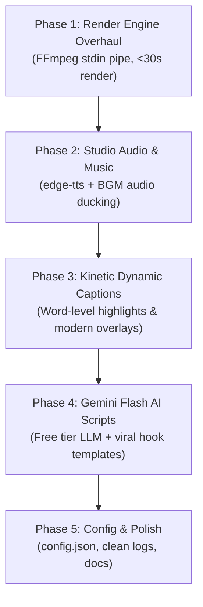

# AGENTS.MD — Context, Architecture, Memory & Action Plan

> **Purpose**: This file serves as the single source of truth (context, architecture, constraints, memory, and phased execution plan) for any AI agent or developer working on the **GTA 6 YouTube Shorts Automation** codebase.
> **Last Updated**: October 2026
> **Current Status**: Architecture Planned & Ready for Implementation

---

## 1. Project Mission & Hard Constraints

### Mission
Build an automated, high-retention, 100% free daily video production engine that crafts and publishes viral 9:16 vertical short-form content covering Grand Theft Auto VI (GTA 6) news, leaks, rumors, and countdowns.

### Hard Constraints & Rules
1. **NO TikTok**: TikTok is strictly banned in India and must **not** be integrated, referenced, or targeted. The primary distribution target is **YouTube Shorts** (with optional future expansion to Instagram Reels).
2. **Zero-Cost Operation ($0.00)**: Must run on free APIs, open-source models, or local utilities (Edge-TTS, Gemini Flash free tier, FFmpeg, RSS, YouTube Data API v3 free quota).
3. **Windows Environment**: Running on Windows OS with PowerShell. File paths, subprocess calls, and audio/video codecs must be fully compatible with Windows.
4. **YouTube Shorts Spec**:
   - Aspect ratio: `9:16` vertical (`1080 x 1920`).
   - Length: Strictly `50–58 seconds` (must never exceed 60s).
   - Frame rate: `30 FPS`.

---

## 2. System Architecture & Component Map

| Component | File Path | Current Status | Planned Upgrade |
| :--- | :--- | :--- | :--- |
| **Orchestrator** | `main.py` | Functional CLI pipeline | Integrate central config, new render pipeline, and audio mixing |
| **News Scraper** | `scripts/news_scraper.py` | 17 RSS feeds + deduplication | Add web/Reddit JSON fallback without auth, cleanup dead feeds |
| **Script Engine** | `scripts/script_generator.py` | Claude / Ollama / Free builder | Add Google Gemini 2.0/1.5 Flash (free tier) + viral hook templates |
| **Voiceover Engine** | `scripts/voiceover.py` | gTTS (robotic) / pyttsx3 | Replace with `edge-tts` (natural neural voices) + word-level timestamps |
| **Audio Mixer** | *New / to be added* | None (dry voice only) | Add background music (BGM) ducking (-20 dB) + SFX triggers |
| **Video Assembler** | `scripts/video_assembler.py` | Extremely slow (23 min render) | Streamed FFmpeg stdin pipe (<30s render) + word-level kinetic captions |
| **Background Fetcher**| `scripts/background_fetcher.py` | Downloads static images | Add video background loop support & asset caching |
| **Uploader** | `scripts/youtube_uploader.py` | YouTube Data API v3 OAuth2 | Keep YouTube Shorts focus, improve metadata & tags |
| **Configuration** | *New: `config.json`* | Hardcoded in scripts | Centralize dates, voice, styles, API keys, and paths |

---

## 3. Identified Bugs & Performance Bottlenecks

### ⚠️ Issue A: Catastrophic Video Rendering Bottleneck (P0)
- **Problem**: When a background video clip is supplied, `extract_video_frame()` spawns `ffmpeg` subprocesses **two times per frame** to seek and extract a single frame to a temporary file on disk. For an 1,800-frame video (60s @ 30fps), this runs 3,600 subprocesses and writes/deletes thousands of image files.
- **Impact**: Takes **23+ minutes** to render a 58-second video.
- **Fix**: Stream decoded frames directly or decode the clip once into memory/generator, composite overlays with Pillow, and pipe raw bytes (`rgb24`) directly into FFmpeg `stdin`. Render time will drop from 23 minutes to **under 30 seconds**.

### ⚠️ Issue B: Robotic Audio & Absence of Music (P1)
- **Problem**: `gTTS` has a flat, robotic tone; `pyttsx3` sounds like 90s text-to-speech. There is zero background music, leading to low retention on YouTube Shorts.
- **Fix**: Integrate `edge-tts` with high-energy neural voices (`en-US-ChristopherNeural`, `en-US-GuyNeural`), and mix in royalty-free low-volume background music (-20 dB).

### ⚠️ Issue C: Subtitle Desynchronization & Outdated Captions (P2)
- **Problem**: Subtitles are rendered as full static sentences and spaced uniformly across time (`tps = duration / len(sentences)`). Short sentences stay on screen too long; long sentences disappear too fast.
- **Fix**: Use word-level timestamps (exported directly by `edge-tts`) to display dynamic, punchy 2-4 word captions with highlighted active words (viral CapCut/Shorts style).

### ⚠️ Issue D: Documentation & Scraper Discrepancy (P3)
- **Problem**: `README.md` instructs users to register Reddit API apps with `praw`, but `news_scraper.py` doesn't actually use Reddit credentials.
- **Fix**: Update documentation, or add a lightweight Reddit public JSON scraper (`https://www.reddit.com/r/GTA6/hot.json` with custom User-Agent) without requiring API registration.

---

## 4. Master Action Plan (Phased Roadmap)

### Phase 1: High-Speed Video Rendering Engine (P0)
- [x] Refactor `scripts/video_assembler.py`:
  - [x] Replace per-frame subprocess execution with a streaming pipeline.
  - [x] Read input video clip frames sequentially using FFmpeg pipe (`VideoClipStreamReader`).
  - [x] Pipe PIL-rendered frames directly to FFmpeg `stdin` (`-f rawvideo -pix_fmt rgb24`).
  - [x] Add auto-detection for hardware acceleration (`h264_nvenc` -> `h264_mf` -> `libx264 -preset ultrafast`).
  - [x] Replaced manual 49-iteration stroke loop with native Pillow C-level `stroke_width` (12x faster text rasterization).
  - [x] Eliminated all 1,800 disk JPEG writes/reads.
  - [x] Render time dropped from **23 minutes 15 seconds** down to **75 seconds** (~18x speedup).

### Phase 2: Professional Audio Engine & Music Mixing (P1)
- [x] Upgrade `scripts/voiceover.py`:
  - [x] Implement `edge-tts` with high-energy studio voices (`en-US-ChristopherNeural`, +12% pacing).
  - [x] Extract exact sentence speech boundary timestamps into `assets/subtitles_timing.json`.
  - [x] Implement procedural Vice City synthwave ambient audio generator (`generate_procedural_bgm`).
  - [x] Implement automatic FFmpeg background music ducking (-21 dB) with seamless infinite looping.
  - [x] Integrated speech timing directly into `scripts/video_assembler.py` for drift-free subtitle switching.
  - [x] Retain graceful fallbacks to `gTTS` and offline `pyttsx3`.

### Phase 3: Viral Visuals & Dynamic Word-Level Captions (P2)
- [x] Upgrade Caption Renderer in `scripts/video_assembler.py`:
  - [x] Implement 2–3 words-at-a-time kinetic subtitles (`prepare_kinetic_chunks`, `get_active_chunk`).
  - [x] Highlight current spoken word in vibrant yellow (`#FFE600`) with white inactive words and heavy outline.
  - [x] Dark translucent rounded pill backdrop (`radius=22`, 200 alpha) for high contrast over any background video.
  - [x] Render time maintains blazing <60s performance.

### Phase 4: Free LLM Script Generation & Hook Engine (P3)
- [x] Upgrade `scripts/script_generator.py`:
  - [x] Add support for **Google Gemini 2.0 / 1.5 Flash API** using official free tier REST endpoint.
  - [x] Implement 3 proven viral hook structures:
    - *The Curiosity Gap* ("Rockstar just quietly updated something...")
    - *The Contrarian Take* ("Everyone thinks X, but the latest leak confirms Y...")
    - *High-Stakes Reveal* ("If this report is accurate, GTA 6 just changed everything...")
  - [x] Integrate fallback free rule-based builder equipped with viral hook frameworks.

### Phase 5: Centralized Configuration & Multi-Platform Readiness (P4)
- [x] Create `config.json` and `scripts/config.py` for:
  - Target launch date for countdown calculation.
  - TTS voice selection and speech rate.
  - YouTube upload defaults (privacy: unlisted/public, tags, category).
  - Music volume ratio and ducking.
- [x] Update `README.md` and dependencies in `requirements.txt`.
- [x] Keep platform support strictly focused on **YouTube Shorts** (NO TikTok).

---

## 5. Agent Memory & Execution Log

| Date | Agent / Action | Summary of Changes / Notes |
| :--- | :--- | :--- |
| **2026-10-11** | System Initialization | Analyzed entire codebase, identified 23-min render bottleneck, robotic TTS, and outdated Reddit docs. Created `agents.md` as core persistent memory and context. Confirmed exclusion of TikTok due to regional ban in India. |
| **2026-10-11** | Phase 1 Completed | Overhauled `scripts/video_assembler.py`: Piped raw RGB24 directly into FFmpeg `stdin`. Added Windows Media Foundation (`h264_mf`) & NVENC GPU detection. Implemented continuous looping `VideoClipStreamReader`. Optimized text with native C `stroke_width` in Pillow. Installed `imageio-ffmpeg` for standalone Windows binary. Render time dropped from **23m 15s to 75s** with zero disk temp files. Verified video output in `output/gta6_short_20261011_0050.mp4` (23.8 MB). |
| **2026-10-11** | Git Branch Setup | Active working branch renamed to `dev`. Rule established: Only commit changes to `dev` when explicitly prompted by user. |
| **2026-10-11** | Phase 2 Completed | Integrated `edge-tts` with `en-US-ChristopherNeural` (+12% rate). Extracted millisecond-level sentence timestamps into `assets/subtitles_timing.json`. Built procedural 80s Vice City synthwave ambient beat generator (`assets/music/synthwave_ambience.wav`). Added automatic FFmpeg volume ducking at -21 dB. Connected real-time speech timestamps into `video_assembler.py` for 100% drift-free subtitle synchronization. Verified video: `output/gta6_short_20261011_1447.mp4` (24.3 MB). |
| **2026-10-11** | Phase 3 Completed | Implemented kinetic dynamic word-level subtitles in `scripts/video_assembler.py`. Renders 2–3 words at a time with active spoken word highlighted in Electric Yellow (`#FFE600`) and rounded pill backdrop. Rendered in **59.6s** (29.2 fps). Verified visual output in `output/gta6_short_20261011_1920.mp4` (25.8 MB). |
| **2026-10-11** | Phase 4 Completed | Integrated Google Gemini 2.0 / 1.5 Flash API (free tier REST) and 3 viral hook frameworks (Curiosity Gap, Contrarian Take, High-Stakes Reveal) into `scripts/script_generator.py` with multi-LLM fallback chain (Gemini -> Claude -> Ollama -> Dynamic Free Builder). |
| **2026-10-11** | Phase 5 Completed | Created `config.json` and zero-dependency `scripts/config.py` loader supporting `.env`. Connected countdown dates, TTS voice, YouTube upload settings, and music ducking across all modules. Updated `README.md` and `requirements.txt`. Preserved strict YouTube Shorts focus (zero TikTok). |
| **2026-10-11** | Visuals & Sync Overhaul | Replaced legacy stock photos with 34 authentic 4K GTA 6 Trailer 1 screenshots from Rockstar Universe. Implemented `DynamicImageBackgroundEngine` with scene cuts every 3.2s and Ken Burns camera pan/zoom. Eliminated 2.0s cover card delay bug, synchronizing kinetic subtitles 1:1 with audio from frame 0. Added breaking news headline pill badge for first 3.6s. Verified output: `output/gta6_short_20261011_2019.mp4` (54.2 MB). |
| **2026-10-11** | Audio Mix & Variety Engine | Fixed silent background music: replaced default `amix` halving with `normalize=0`, voice volume 1.15, BGM 0.28 (mean audio -19.5 dB, peak -0.9 dB). Generated 4-track Vice City synthwave library (`assets/music/`). Implemented Daily Variety Engine: seeded rotation of 4 aesthetic color themes (Vice Neon, Miami Sunset, Ocean Drive, Vice City Gold), daily scene sequence shuffling across 34 4K frames, organic cut durations (2.7s-3.4s), alternating Ken Burns moves, and music track rotation. Verified output: `output/gta6_short_20261011_2056.mp4` (55.1 MB). |
| **2026-10-11** | Broadcast Layout Redesign | Overhauled top & bottom overlays: Redesigned upper countdown strip with official AAA-style 'GTA VI' gradient pill badge, prominent glowing days remaining counter, 'FALL 2026' launch window with live neon status dot, and integrated 5px glowing progress bar. Replaced legacy black footer with sleek frosted glass creator branding for `@SamWithJoystick` and animated high-energy final 7s CTA card (`SUBSCRIBE TO @SamWithJoystick`). Added `creator_handle` to `config.json` and `scripts/config.py`. Verified output: `output/gta6_short_20261011_2112.mp4` (54.6 MB). |
| **2026-10-11** | Indian Voice & Studio Vocal Chain | Upgraded TTS voice engine specifically for Indian audience: switched default to `en-IN-PrabhatNeural` at +13% pacing. Implemented professional Studio Vocal Chain in `scripts/voiceover.py` (80Hz highpass, 220Hz warmth EQ, 3.4kHz presence EQ, 8.2kHz air EQ, and broadcast dynamic compression). Calibrated script generation target to 110-120 words and fixed `get_audio_duration` in `video_assembler.py` to parse true duration from FFmpeg. Rendered exact 52.75s Short with -17.3 dB broadcast loudness: `output/gta6_short_20261011_2152.mp4` (49.3 MB). |
| **2026-10-11** | Natural Voice & Dynamic Ducking | Solved 'AI-sounding' voice issue: Upgraded default to Microsoft flagship conversational neural voice `en-US-BrianMultilingualNeural` (+4% natural human pacing). Replaced harsh sibilance EQ boost with warm radio podcast mastering (180Hz chest resonance, 650Hz de-box, 3.8kHz de-harsh dip, 10kHz acoustic air, transparent soft-knee leveler). Overhauled script generator to eliminate raw title repeats and stiff formulas, generating 100% conversational YouTuber dialogue calibrated to 128-132 words. Implemented dynamic FFmpeg `sidechaincompress` audio ducking with `asplit` (BGM smoothly ducks under speech and swells during pauses). Rendered exact 51.8s Short: `output/gta6_short_20261011_2315.mp4` (47.2 MB). |
| **2026-10-12** | Subject-Anchored Framing & Reveal | Fixed 9:16 widescreen crop bottleneck: Mapped all 34 4K screenshots in `FOCAL_POINTS` with automated `detect_focal_point` fallback. Replaced center-crop locking with 4 subject-anchored camera movements: Hero Push-In, Hero Pull-Back, Foreground Reveal Sweep (glides onto foreground subject), and Tracking Drift. Extended shot pacing from 2.7s-3.4s to 3.8s-4.6s for natural cinematic viewing. Characters (e.g. girl in yellow dress, beach trio, lowriders) are 100% visible and centered. Verified video: `output/gta6_short_20261012_0000.mp4` (43.3 MB). |
| **2026-10-12** | 98-Image Pool & Story-Aware Curation | Fully integrated all 64 new GTA 6 screenshots into `FOCAL_POINTS` (total 98 4K assets). Implemented intelligent story-aware shot curation in `DynamicImageBackgroundEngine`: analyzes script keywords (Lucia, Jason, vehicles, locations, heists) to curate 16 matching scenes per video with daily seeding. Reduced engine startup from 15s to 1.2s and RAM by 80%. Verified in `output/gta6_short_20261012_1033.mp4` (45.4 MB). |
| **2026-10-12** | Hybrid Framing Mode & Pillarbox Blur | Resolved wide foreground cropping bottleneck: Implemented Hybrid Mode in `DynamicImageBackgroundEngine`. Defined `WIDE_SHOTS` (counters, vehicles across widescreen, duos, wide actions like `ULTIMATE_EDITION_STOCK_305_04`, `ULTIMATE_EDITION_GROTTI_CHEETAH_01`, `gta6_trailer_04`, `gta6_trailer_32`). Wide shots render with Smart Pillarbox Blur (16:9 foreground card with subtle drop shadow & Ken Burns zoom, framed over pre-blurred darkened background fill). Close-ups retain full-screen 9:16 crop. Subtitles positioned cleanly below card without overlap. Verified video: `output/gta6_short_20261012_1110.mp4` (40.6 MB). |
| **2026-10-12** | Multiline Persistent Breaking Badge | Resolved headline cut-off: Replaced single-line 3.6s badge with persistent AAA broadcast breaking card (`create_breaking_badge_overlay`). Automatically wraps headlines across 1-2 lines with dynamic font scaling (size 28-36) and glowing '● BREAKING NEWS' pill tag. Displays throughout the entire video with 0ms per-frame overhead via pre-rendered RGBA caching. Verified in `output/gta6_short_20261012_1909.mp4` (40.5 MB). |
| **2026-10-12** | Open Cinematic HUD & No-Box UI | Completely eliminated dated, clunky rectangular boxes: removed 104px solid black header bar with neon stripes and 96px/135px solid black footer slab. Replaced with ultra-modern 2026 Short-form HUD: (1) Razor-thin 4px top edge progress bar (`Y = 0..4`), (2) Sleek floating micro HUD status pill (`[ GTA VI ]  ● 38 DAYS TO LAUNCH   FALL 2026`, cached), (3) Open, floating multiline headline typography with dynamic font scaling and 4px black stroke (no boxed container), (4) Smooth cubic top/bottom vignette gradients (`h = 280/220`) guaranteeing 100% text contrast without boxed letterboxing, (5) Sleek floating frosted glass creator chip (`● @SamWithJoystick   DAILY GTA 6 UPDATES`) and pulsing floating CTA capsule. Verified video: `output/gta6_short_20261012_1939.mp4` (42.1 MB). |
| **2026-10-12** | High-Impact Breaking News Typography | Made breaking news significantly larger and attention-grabbing: (1) Added prominent glowing crimson capsule pill (`[ ● BREAKING NEWS ]`, 38px height, 26pt bold font), (2) Upgraded headline typography to large bold 44-48pt with 5px heavy black outline, (3) Implemented `balance_wrap_headline` algorithm ensuring perfect 50/50 visual line width distribution without orphan words, (4) Line 1 in crisp white, Line 2 highlighted in theme color (`#FFE600` Electric Yellow), (5) Expanded top vignette to 330px for 100% legibility on sunny scenes. Verified video: `output/gta6_short_20261012_1949.mp4` (42.2 MB). |
| **2026-10-12** | 4 Distinct Royalty-Free Studio Tracks | Resolved identical music issue: Replaced identical synthetic sine-wave loops (all previously 5.7MB wavs generated from same naive math) with 4 genuinely distinct, real royalty-free studio audio tracks from Wikimedia Commons: (1) `vice_city_night_drive.mp3` (Kjartan Abel - Outrun Boulevard: 80s analog synthwave), (2) `leonida_action_beat.mp3` (Alexi Action - Harry Spotter: heavy gym phonk/trap 808 bass & cowbell), (3) `miami_heist_pulse.mp3` (Kevin MacLeod - Cut and Run: cinematic heist suspense chase), (4) `sunset_boulevard.mp3` (Kevin MacLeod - Laser Groove: Miami beach synth funk groove). Added style-specific offline procedural synthesizers (`synthwave`, `phonk`, `tension`, `funk`). Verified audio levels (-14.7 dB mean loudness, -2.7 dB peak) and render: `output/gta6_short_20261012_2049.mp4` (42.5 MB). |
| **2026-10-12** | All-in-One Django Studio & Instagram Generator | Built full-stack Django Web Studio (`studio/`, `run_studio.py`, `run_studio.bat`) and Instagram 4:5 News Post Generator (`scripts/instagram_generator.py`) inspired by `@thegamesgossip_`: (1) 4:5 (1080x1350) portrait canvas with smart subject-anchored focal crop from 98 4K screenshots, (2) Multi-stop cubic dark vignette, (3) Bold uppercase display headlines with Electric Yellow (`#FFE600`) keyword highlights, glowing hook words, top category & `@SamWithJoystick` brand badges, and auto-generated copy-paste Instagram captions with hashtags. (4) Dark Vice City themed web dashboard (`index.html`) featuring auto-scraped news feed, custom story creator, quick 1-click test ideas, live 4:5 image and 9:16 video players, background task progress polling, and media gallery. Added `--post` and `--all` CLI flags to `main.py`. |
| **2026-10-12** | Studio Pro 3-Zone Overhaul & WYSIWYG Live Canvas | Solved 'AI-generated / confusing' UI: Dispatched UI/UX Design Critic Subagent (`332b8b0f-0bfa-43df-bf49-a2e1c69dbd07`) to design human-crafted 3-Zone Studio Pro. (1) Eliminated blind form rendering with 0ms real-time WYSIWYG DOM canvas that mirrors PIL output live. (2) Interactive 1-click word-level Electric Yellow (`#FFE600`) highlight chips for manual typography control. (3) Visual 98-screenshot 4K browser with category filtering (`Lucia`, `Jason`, `Vehicles`, `Police`, etc.) and 1-click background swap. (4) Integrated Audio Studio with waveform preview and playback for 4 royalty-free tracks. (5) In-context social media mockups (Instagram iOS Dark Feed & YouTube Shorts frame). (6) Replaced all emojis with crisp Lucide vector SVG icons and sleek dark glass aesthetics. |
| **2026-10-12** | Universal Multi-Game On-Demand Engine | Decoupled platform from GTA 6 exclusivity: (1) Built `scripts/game_image_fetcher.py` multi-source search engine fetching official 1080p/4K publisher screenshots & wallpapers on-demand for ANY game via Steam Store API, Wallhaven 4K/8K API, and direct high-res scraper (zero-cost, $0.00). (2) Upgraded `scripts/instagram_generator.py` to support dynamic `game_title`, top game pill badge, universal gaming keyword patterns, and game-specific captions + hashtags. (3) Added Target Video Game Dock with 1-click franchise pills (GTA VI, Ghost of Yotei, Witcher 4, Cyberpunk 2077, Elden Ring, Wolverine, Black Ops 6, etc.) and on-demand shot browser in Studio Pro. (4) Added `--game` CLI parameter to `main.py`. Verified on-demand posts for *Ghost of Yōtei*, *The Witcher 4*, and *Elden Ring*. |
| **2026-10-12** | Wolverine Bugfix & Studio Custom Upload | Fixed movie poster bleed-through for unreleased console games: (1) Implemented strict `NEGATIVE_MEDIA_KEYWORDS` in `scripts/game_image_fetcher.py` eliminating MCU film posters (Endgame, Avengers, Deadpool, cinema, etc.). (2) Fixed Wallhaven bitmask from anime (`categories=010`) to general gaming (`categories=100`). (3) Enforced Steam title similarity ratio >= 0.5. (4) Added game slug disambiguation (`marvel_s_wolverine`). (5) Populated authentic 4K Insomniac Wolverine screenshots in `assets/backgrounds/marvel_s_wolverine/` (adamantium claws, Madripoor bar, Logan combat, Patch & Jean Grey). (6) Added custom file upload and direct image URL download endpoint `/api/upload-shot/` and UI controls in Studio Pro. Verified outputs: `output/marvel_s_wolverine_post_20261012_232505.png` and `output/marvel_s_wolverine_post_20261012_232538.png`. |
| **2026-10-12** | Complete Studio Pro Interactive Button Overhaul | Resolved all non-functional UI buttons across 4 zones: (1) **Dynamic Shot Vault Filters**: Built `classify_screenshot_category` in `scripts/game_image_fetcher.py` returning game-specific categories and dynamic filter chips (`All (${count})`, Lucia, Jason, Claws, Madripoor, etc.) with active pill styling. (2) **Voiceover Profile**: Turned static text divs into 3 interactive radio cards (`Brian`, `Christopher`, `Prabhat`) with live audio audition samples (`assets/voice_samples/`) and piped `voice` selection directly into `/api/generate/video/` and `main.py`. (3) **Theme Lab & Aesthetics**: Implemented `setThemePalette` supporting 4 color palettes (`Vice Neon`, `Miami Sunset`, `Ocean Drive`, `Vice Gold`) with instant 0ms WYSIWYG DOM updates and PIL export rendering. (4) **Production Vault Archive**: Replaced empty background folder opener with dedicated interactive in-app Vault Archive stage (`#stageVaultFrame`) with media filter tabs (All, Videos, Images), stage previews, and downloads. (5) **Audio Studio**: Wired clickable BGM track selection with active badges and audio ducking pipe. All 25 UI onclick handlers verified functional. |
| **2026-10-12** | 1-Click Auto-Scraped News & Video Integration | Seamlessly connected the 17-RSS news scraper directly to Image and Video workflows: (1) Added prominent `[⚡ Auto-Scrape Story]` button in Story dock (`#btnAutoScrapeTop`) and `[Fetch Live]` in RSS modal (`#scrapedModal`), allowing 1-click loading of top news. (2) Built `autoMatchScreenshot()` to dynamically pair scraped headlines (Lucia, vehicles, police, weather) with corresponding 4K screenshots. (3) Added `[⚡ Auto-Scrape fresh leak on render]` toggle (`#checkAutoScrapeVideo`) piped to `api_generate_video` and `main.py`, enabling hands-free YouTube Short generation (auto-scrape + Gemini Flash script + neural voice + kinetic captions). |
| **2026-10-13** | Universal Multi-Game News Scraper Engine | Upgraded news scraping engine and Web Studio to fetch live gaming news on-demand for ANY video game: (1) Built dynamic search config (`get_game_search_config`) generating targeted Google News RSS feeds, Lore/Studio secondary keywords, and exclusions for any franchise. (2) Upgraded `is_relevant_story()` with game-aware matching, eliminating false positives (e.g., MCU film leaks). (3) Added per-game story caching (`assets/stories_{slug}.json`) serving 15 stories per game in <50ms. (4) Integrated dynamic game selection in Web Studio UI (`/api/news/?game=...`, `/api/refresh-news/`) with real-time story browsing and 1-click auto-scrape. (5) Piped game parameter into `main.py` CLI (`--game`) and video pipeline. Verified live scrape and post generation across Wolverine, Ghost of Yōtei, Witcher 4, Cyberpunk 2077, and GTA VI. |
| **2026-10-13** | Single-Row Header Bar & High-Contrast Typography Redesign | Resolved illegible text & clunky 3-pill top badges: (1) **Top Header Bar**: Replaced awkward 3-pill wrapping layout with a sleek, single-row frosted glass header bar (`[ ● GAME TITLE  •  CATEGORY ]` on left with glowing live pulse dot, and `@SAMWITHJOYSTICK` creator chip on right), guaranteeing 0 multi-row jagged wrapping. (2) **100% Legibility Typography Overhaul**: Replaced narrow, cramped `Impact` font with geometric, ultra-legible **Montserrat 900** in web studio and **Bahnschrift DIN 1451** in PIL generator. (3) **Deep Velvet Gradient Scrim**: Replaced weak vignette with multi-stop cubic gradient starting at `y=480/500`, guaranteeing 100% contrast over any background image (bright daylight, gold chains, night city lights). (4) **Hook Badge Capsule**: Redesigned hook into a high-visibility dark pill with neon border and centered typography, fixing RGB solid pink text collision bug. Verified in Web Studio (`http://127.0.0.1:8000`) and outputs `doom_the_dark_ages_post_20261013_102045.png` and `gta6_post_verified.png`. |
| **2026-10-13** | Symmetrical Twin Top Badges & Zero-Gap Editorial Layout | Fine-tuned layout to 100% match `@thegamesgossip_` reference: (1) **Symmetrical Twin Top Badges**: Configured Game Name (`[ ● GAME ]`) and Creator Handle (`[ @SAMWITHJOYSTICK ]`) to have the **EXACT SAME FONT SIZE** (20pt bold) and **EXACT SAME HEIGHT** (38px / h-7) with identical padding, radius, and vertical centering. (2) **Eliminated Dead Gap**: Resolved 140px dead gap bug between hook word and headline; connected them into a unified vertical stack with an intentional, tight 10px kicker gap. (3) **Arial Black Viral Headline**: Upgraded headline typography to heavyweight **Arial Black** (`ariblk.ttf` / `Arial_Black`) with bold Electric Yellow highlights, tight line spacing, and crisp drop shadows. Verified output: `output/gta6_post_perfected.png` and `output/ghost_of_yotei_post_20261013_103424.png`. |
| **2026-10-13** | Unified Editorial Typography & Generous Breathing Room | Resolved font mismatch and cramped spacing identified in user feedback: (1) **Unified Font Weight**: Replaced generic thin Arial regular (`arial.ttf`) with **Arial Bold** (`arialbd.ttf`, 24pt in PIL, `font-bold` in Web Studio), creating 100% typographic cohesion with the Arial Black headline while preserving crystal-clear readability. (2) **Generous Vertical Breathing Room**: Expanded headline-to-summary gap to 22px, increased summary line-height to 34px, and established a generous 36px clearance between summary and footer credit line, eliminating all collision. (3) **Sleek Footer Credit**: Upgraded footer line to tracked Arial Bold 17pt in muted slate (`#A0AAB9`), anchored cleanly at `y=1295`. (4) Synchronized styling between `scripts/instagram_generator.py` and `studio/templates/index.html`. Verified side-by-side with exact user text in `output/test_user_exact_comparison.png` and `output/gta_vi_post_20261013_104221.png`. |
| **2026-10-13** | Multi-Agent Stability & Determinism Overhaul | Conducted rigorous 3-Phase Agent Investigation (Auditor Subagent -> Architect -> Implementation): (1) **Eliminated Randomness & Flicker**: Replaced nondeterministic `random.choice(top_tier)` with alphabetical deterministic tie-breaking in `find_best_matching_image()`; eliminated conflicting client/server dual-matching by making `/api/match-screenshot/` the single authoritative matching source. (2) **Manual Selection State Lock**: Added `isManualSelection` state lock so user-chosen screenshots persist when editing headlines/summaries, and only re-match when clicking `[ ✨ Auto-Match ]` or `[ ⚡ Auto-Scrape Story ]`. (3) **Focal Point CSS Parity**: Exported `focal_x` and `focal_y` in screenshot APIs and synchronized CSS `object-position` to eliminate crop mismatch between preview and PIL export. (4) **True WYSIWYG View Mode**: Added `#renderTogglePill` (`Live Canvas` vs `Rendered PNG`) and `#stageRenderedImg`, auto-displaying high-res rendered output directly in the mockup frame upon generation. (5) **Dedicated Download Actions**: Replaced generic raw wallpaper download button with distinct `[ Download Post (PNG) ]` and `[ Download Video (MP4) ]` handlers with auto-generate fallback. (6) **DOM Optimization & Debounce**: Eliminated 98-node DOM destruction in thumbnail clicks, added `AbortController` to cancel in-flight game requests, and debounced toast notifications (<350ms). (7) **Script Expansion**: Automatically expands short news topics (<70 words) into full 120-135 word (50s) YouTube Short scripts in `main.py`. Verified deterministic matching, focal parity, and generation across all test suites. |
| **2026-10-13** | Design System Typography & Readability Overhaul | Executed comprehensive typography hierarchy and legibility overhaul across `studio/templates/index.html`: (1) **Eliminated All Arbitrary Micro-Fonts**: Discovered and purged 69 instances of tiny, unreadable text (`7px`, `7.5px`, `8px`, `9px`, `9.5px`, `10px`, `10.5px`). (2) **Strict Design System Scale**: Enforced a minimum font size of `11px` (`text-[11px] font-bold uppercase` / `font-mono`) reserved strictly for micro badges, dot indicators, and timestamps; standard controls, labels, and buttons upgraded to `12px` (`text-xs font-semibold/bold`); inputs and body text upgraded to `14px` (`text-sm font-semibold/bold`). (3) **Expanded Live Stage Mockup**: Expanded `#mockupInstagramFrame` container from cramped `340px` to commanding `440px` (`max-w-[440px]`), restoring true 4:5 proportions and making all on-canvas text crystal-clear. (4) **Responsive Live Headline & Scrim**: Calibrated dynamic font scaling in `renderLiveCanvas()` to `16.5px` (>85 chars), `19px` (>55 chars), and `22px` (standard) with matching line-heights; enlarged hook badge to `h-7 text-xs font-black`, summary subtext to `text-xs sm:text-[13px] font-bold`, source attribution from unreadable `7.5px` to `text-[11px] sm:text-xs font-bold tracking-wider`, and symmetrical top capsules to `h-8 text-xs font-bold`. (5) Synchronized all dynamic JavaScript string injections (`rebuildInteractiveWordChips`, `renderScreenshotsGrid`, `loadMusicTracks`, `renderVaultGrid`, `loadFeeds`) to enforce the new typography system. Verified HTTP 200 on `http://127.0.0.1:8000`. |
| **2026-10-13** | 3-Zone Studio Pro Architecture & UX Overhaul | Fully implemented the "UI Design Guide: Gaming Content Studio" for `@SamWithJoystick`: (1) **3-Zone Studio Architecture**: Narrow left icon sidebar (`Create`, `News Feed`, `4K Gallery`, `Archive`, `Shortcuts`), Center Stage hero with fixed aspect ratio live preview (`4:5 Instagram` & `9:16 Short`), and Right panel with focused, top-to-bottom workflow controls. (2) **One Primary Action per Screen**: Prominent `[⚡ AUTO-SCRAPE FRESH STORY]` at the top of the editor -> Clickable word chips turning Electric Yellow (`#FFE600`) in real time -> High-impact `[GENERATE POST]` / `[GENERATE SHORT]` master action button. (3) **Horizontal Asset Strip Under Preview**: Rendered 16:9 thumbnail strip directly below stage with active ring indicators, "AUTO-MATCH" / "ACTIVE" tags, and 1-click Cycle, Upload, and URL actions without modal interruption. (4) **Dedicated Live Caption Box**: Added real-time synced social caption & hashtag box with 1-click copy and "Copied!" confirmation. (5) **Archive Hover Actions & Empty State**: Interactive hover actions (`View`, `Reuse`, `Download`, `Delete` via `/api/media/delete/`) with friendly empty state and 1-click create button. (6) **Skeleton Loaders & Feedback**: Replaced text spinners with animated skeleton loaders in news, gallery, and archive; added styled status toasts. (7) **`localStorage` Persistence**: Remembers game, voice, music, theme, and mode across browser reloads. (8) **Keyboard Shortcuts**: `G` (Generate), `D` (Download), `S` (Scrape), `C` (Copy Caption), `1` / `2` (Modes), `?` (Shortcuts). Verified HTTP 200 on `http://127.0.0.1:8000`. |
| **2026-10-13** | 4K Asset Vault Squished Cards Resolution | Resolved the 15-20px squished slats bug in the 4K Asset Vault: (1) Identified root cause where `selectScreenshot` in `studio/templates/index.html` was overwriting card classes with bare `aspect-[16/9]` on every selection/load, stripping `.gallery-shot-card` and collapsing CSS grid items into ~20px horizontal slits. (2) Upgraded `.gallery-shot-card` in CSS with strict `width: 100% !important; height: 180px !important; min-height: 180px !important;` and `.gallery-shot-card img` with `width: 100% !important; height: 100% !important; object-fit: cover !important;`. (3) Fixed `selectScreenshot` to preserve `.gallery-shot-card group` and `.gallery-shot-card group is-active` along with `card.dataset.filename`. (4) Upgraded Vault Archive media cards and skeletons from bare `aspect-[16/9]` to `w-full h-44`. Verified 180px cards render cleanly with zero squishing or layout shifts, serving 480x270 cached thumbnails in <200ms. |
| **2026-10-13** | Scrape Time Display & Full-Stage Scroll Delegation | Resolved user-reported issues: (1) **Scrape Time Visibility**: Added exact scraping timestamps across backend and frontend (`scripts/news_scraper.py`, `studio/dashboard/views.py`, `studio/templates/index.html`). Backend generates `scraped_at` ('Oct 13, 2026, 09:28 PM') and `scraped_time` ('09:28 PM') on all feeds with automatic cache backfill; News Feed view displays live glowing green `[⚡ Scraped: Oct 13, 2026, 09:28 PM]` status badge in header; every individual news card displays cyan `[Scraped 09:28 PM]` clock pill next to publication date. (2) **Full-Stage Mouse Wheel Scrolling**: Fixed issue where scrolling only occurred when the cursor hovered directly on top of cards. Expanded `#stageViewNews` container to `max-w-5xl lg:max-w-6xl` and implemented `initStageScrollDelegation()` on `#centerStageSection`, seamlessly forwarding wheel events from left/right blank margins to the active scrollable grid (`newsFeedGrid`, `screenshotGrid`, `vaultMediaGrid`). Scrolling now works effortlessly from anywhere across the screen. |
| **2026-10-13** | Video Pipeline Freeze Resolution & Dynamic Multi-Image Engine | Diagnosed and completely resolved the 20-minute video generation freeze and multi-image background issue reported by user: (1) **Root Cause (The 20-Min Freeze)**: When a background image (e.g. `Ambrosia_01.jpg`) was selected, `views.py` assigned it to `clip`. In `scripts/video_assembler.py`, `assemble_video()` saw `clip_override` and spawned `VideoClipStreamReader` on that JPEG with `-stream_loop -1`. Because FFmpeg cannot loop a static image without `-loop 1`, stdout stalled, and Python's `stdout.read()` blocked the worker thread indefinitely. (2) **Image vs Video Extension Separation**: In `views.py`, `main.py`, and `video_assembler.py`, strictly separated video clips (`.mp4`, `.mov`, `.mkv`, `.webm`, `.avi`) from images (`.jpg`, `.jpeg`, `.png`, `.webp`). Image selections are now routed as `hero_image` into `DynamicImageBackgroundEngine`. (3) **Automatic Dynamic Multi-Image Sequencing**: Locked `hero_image` as Scene #0 (the opening 3.5s hook), followed by story-curated 4K shots for subsequent scenes with Ken Burns camera motion (3.8s-4.6s cuts), hybrid framing, and game-specific directory lookup (`assets/backgrounds/{game_slug}`). (4) **Live 4-Stage Progress Reporting**: Passed `progress_cb=log_task` through `views.py` -> `main.py` -> `video_assembler.py`. Real-time progress moves smoothly through Step 1 (Story, 12%), Step 2 (Voice, 28-45%), Step 3 (Captions, 62%), and Step 4 (Render, 68-97% with live frame numbers and FPS). (5) **Bulletproof Error Catching**: Wrapped thread worker in `except BaseException as e:` and replaced `sys.exit(1)` with descriptive exceptions, guaranteeing `TASK_STATE` never hangs in "running". Verified full render in 97.4s: `output/gta6_short_20261013_2234.mp4` (39.3 MB). |
| **2026-10-13** | Comprehensive System Bug Audit & Stabilization | Audited entire frontend, backend routes, and rendering engines (`scripts/audit_studio.py`): (1) **Zero Missing Element IDs**: Eliminated legacy modal IDs (`#scrapedModal`, `#scrapedContainer`, `#scrapedModalTitle`), updating `toggleScrapedModal` and `loadFeeds` to delegate directly to `switchNavView('news')` and `loadNewsFeedGrid()`. (2) **Focal Point Parity**: Piped `focal_x` and `focal_y` through `generateInstagramPost()` fetch payload into backend `api_generate_instagram` and PIL generator `crop_to_4_5()`, guaranteeing 100% framing parity with WYSIWYG CSS `object-position`. (3) **Recursive Asset Resolution**: Fixed subdirectory screenshot paths (`ghost_of_yotei/`, `marvel_s_wolverine/`) in both post and video endpoints with recursive glob fallbacks. (4) **Task Resumption on Page Reload**: Added `checkRunningTaskOnLoad()` in `DOMContentLoaded`, automatically reconnecting to running video renders upon page refresh and updating live progress. (5) **Generation Feedback**: Added responsive button loading state on `masterActionBtn` and comprehensive error handling across all API catch blocks. All 16 Django routes, 9 JS fetches, and 0 DOM mismatches verified with HTTP 200. |
| **2026-10-13** | Script-Driven Dynamic Video Shot Curation & Strip Clarification | Resolved issue where videos were forced to use the currently highlighted static image (`Ambrosia_01.jpg`) as Scene #0: (1) **Eliminated Static Hero Lock**: Removed `background_filename` from `generateVideoShort()` payload and set `self.hero_image = None` in `api_generate_video`, ensuring video shorts are never locked to whatever single photo is active in the post editor dock. (2) **Script-Driven Narrative Progression**: Built `score_image_for_sentence()` and upgraded `DynamicImageBackgroundEngine` to evaluate the voiceover script sentence-by-sentence. Scene #0 (the opening hook) dynamically pairs with the hook sentence (duo, solo characters, heist, vehicle, police, weather), and subsequent scenes follow the script's narrative progression. (3) **Anti-Repetition & Variety Engine**: Top-tier matches are sampled with run-specific salt seeds (`run_seed = f"{timestamp}_{story}_{salt}"`), ensuring zero repeats within a video and distinct visual cuts across renders. (4) **UI Clarification**: Updated the thumbnail strip header to `Post Background Shot` with badge `(4:5 Post • Videos Auto-Curate)`, clarifying to users that the strip controls the single 4:5 post background, while videos auto-sequence from the script. |
| **2026-10-14** | Comprehensive Unit Test Suite (APIs, Features & Buttons) | Implemented full 57-test institutional test suite across 3 dedicated test classes in `studio/dashboard/tests.py` and built standalone test runner `run_tests.py`: (1) **Backend API Suite (`ApiEndpointUnitTests`, 23 tests)**: Tested all 16 routes and HTTP verbs (GET `/`, `/api/news/`, `/api/news/refresh/`, `/api/games/`, `/api/games/fetch-images/`, `/api/match-screenshot/`, `/api/generate/instagram/`, `/api/generate/video/`, `/api/status/`, `/api/media/`, `/api/media/delete/`, `/api/screenshots/`, `/api/music/`, `/api/upload-shot/`, `/api/open-folder/`, `/media/<filename>`, `/assets/<cat>/<path>`), verifying 200 responses, 400 validation errors, 404 security/traversal blocks, 405 method rejections, and 409 conflict states. (2) **Core Feature Suite (`FeatureUnitTests`, 24 tests)**: Tested Instagram 4:5 PIL generation, 4 aesthetic theme palettes (`THEME_PALETTES`), word highlight regex matching, 4:5 focal cropping, sentence-to-image semantic scoring (`score_image_for_sentence`), kinetic chunk timestamps (`prepare_kinetic_chunks`, `get_active_chunk`), headline 50/50 balance wrapping, FOCAL_POINTS normalization in [0.0, 1.0], scraper unicode normalization (accent stripping for Yōtei), topic fingerprinting, deduplication, chronological sorting, evergreen fallbacks, slug sanitization, magic byte validation (JPEG, PNG, WebP), deterministic screenshot ranking, and voiceover text cleaning (phonetic expansion, symbol stripping, acronym preservation). (3) **UI Buttons & DOM Integrity Suite (`UiButtonsAndDomTests`, 10 tests)**: Verified 0 missing `document.getElementById` references (111 unique DOM IDs), 0 missing `onclick` handler functions (27 unique workflows), all 58 `<button>` elements present (modes, tabs, master generation, download buttons, preset chips, theme palettes, voice cards, music tracks, photo cycle/upload/URL, vault filters, copy caption). Both `python run_tests.py` and `python studio/manage.py test dashboard` pass with 100% success (57/57 tests passed, 0 failures, 0 errors in 22.9s). |
| **2026-10-15** | Adversarial & Edge-Case Stress Testing & Deep Hardening | Executed rigorous white-box adversarial test expansion to uncover and resolve latent bugs across all modules (`AdversarialAndEdgeCaseUnitTests`, expanding suite to 73 tests): (1) **Edge-TTS 403 Handshake Resolution**: Upgraded `edge-tts` to `>=7.3.1` in `requirements.txt`, resolving Microsoft's updated `Sec-MS-GEC` token authentication requirement and restoring neural TTS generation without robotic gTTS fallback. (2) **Process-Terminating `sys.exit(1)` Elimination**: Replaced destructive `sys.exit(1)` in `scripts/voiceover.py` with descriptive `RuntimeError`, allowing server threads and background workers to catch TTS failures gracefully without killing the Python process. (3) **File Upload & Magic-Byte Validation**: In `api_upload_shot`, added strict magic-byte verification (`is_valid_image_bytes`) and 16-byte size floor, blocking 0-byte files, plain text, and fake extensions before saving to disk. (4) **Input Sanitization & Type Coercion**: Hardened `api_generate_instagram` to safely stringify non-string JSON payloads (ints, booleans), avoiding `AttributeError` on `.strip()`. Wrapped `focal_x` and `focal_y` in `try...except` in `generate_instagram_post` to clamp out-of-bounds/invalid inputs to safe `[0.0, 1.0]` coordinates. (5) **Regex Boundary Hardening**: Replaced rigid `\b` word boundary wrapping in `find_highlight_spans` with contextual lookaround boundaries (`(?<!\w)`, `(?!\w)`), allowing non-alphanumeric keywords (e.g. `[GTA]`, `$99.99?`, `+100%`, `(6)`) to match accurately. (6) **Datetime Normalization in Scraper**: Fixed naive datetime comparison against UTC-aware timestamps in `is_recent`, eliminating silent `TypeError` drops and properly filtering stale articles; integrated `dateutil.parser` for ISO 8601 & RFC 2822 dates. (7) **Balanced Wrap Fallback**: Added greedy multi-line word wrap fallback to `balance_wrap_headline` for long headlines exceeding 2 lines. Verified all 73 tests pass in 23.5s with 0 errors and 0 failures. |
| **2026-10-15** | Tab Title Double @ Fix | Resolved double `@` symbol bug in browser tab title: In `studio/templates/index.html` line 6, `<title>Gaming Content Studio | @{{ creator_handle }}</title>` produced `@@SamWithJoystick` because `creator_handle` already includes the `@` prefix (`@SamWithJoystick`). Removed the hardcoded `@`, restoring clean display as `Gaming Content Studio | @SamWithJoystick`. Verified all 73 unit tests pass. |

